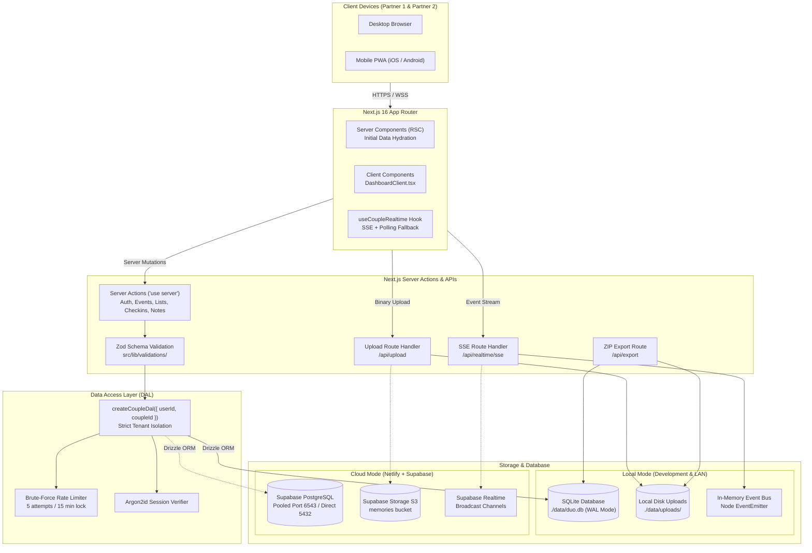
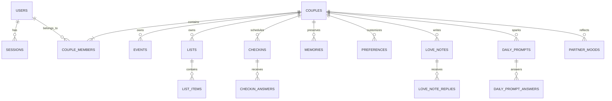

# Architecture Specification: Duo

> **System Overview**: High-performance, offline-capable, couple-isolated web application designed for Next.js 16, Drizzle ORM, and hybrid SQLite / Supabase PostgreSQL architectures.

---

## 1. System Architecture Diagram

---

## 2. Architectural Layers

### 2.1 Presentation Layer (Frontend)
- **Next.js 16 App Router (`src/app`)**:
  - `page.tsx`: Top-level Server Component. Validates session with `getCurrentAuth()`, redirects unauthenticated traffic to `/login` or unlinked partners to `/pair`, fetches initial datasets via the DAL, and passes hydrated state into `DashboardClient.tsx`.
  - `DashboardClient.tsx`: Rich interactive sanctuary shell managing active tabs, optimistic updates, and client audio synthesis.
- **Micro-Interaction Subsystems**:
  - `useCoupleRealtime.ts`: Subscribes to Server-Sent Events (`/api/realtime/sse`). If SSE fails (e.g. proxy disconnect), automatically degrades to a 5-second polling fallback (`/api/realtime/poll`) without dropping updates.
  - **Synthesized Rain Soundscape**: Implemented natively via Web Audio API (`AudioContext`, pink noise generation, biquad lowpass filtering), requiring zero external audio assets.

### 2.2 Backend & Service Actions Layer
- **Next.js Server Actions (`src/lib/actions/`)**:
  - Strongly typed RPC mutations executing on the server with direct database access.
  - Every action validates incoming payloads with strict **Zod schemas** before database interaction.
  - Emits real-time event notifications via `publishCoupleEvent(coupleId, event)` to wake up the partner's screen.
- **Route Handlers (`src/app/api/`)**:
  - `/api/realtime/sse`: Persistent HTTP streaming connection delivering live JSON events.
  - `/api/upload`: Multipart photo upload handler with MIME validation and directory traversal prevention.
  - `/api/export`: Streams a compressed `.zip` archive containing both the full JSON database dump and raw memory images.

### 2.3 Data Access Layer (DAL) & Security
- **Couple Scoping Enforcement (`src/lib/dal/index.ts`)**:
  - **Rule**: No query is ever executed with global scope.
  - The DAL factory `createCoupleDal({ userId, coupleId })` encapsulates all operations into sub-modules (`events`, `lists`, `checkins`, `memories`, `preferences`, `loveNotes`, `dailyPrompts`).
  - Every SQL condition includes `where: eq(table.coupleId, coupleId)`.
- **Brute-Force Rate Limiting (`src/lib/auth/rate-limit.ts`)**:
  - Monitored by composite keys (`email:ip`).
  - Failed logins increment counters in the `login_attempts` table.
  - Exceeding 5 failures results in a strict 15-minute lock.

---

## 3. Database Schema Architecture

### Table Relationships
- **`couples`**: Root space entity. Holds the 8-character invite code (`DUO-LOVE`), pairing status (`pending` $\to$ `paired`), and anniversary date.
- **`couple_members`**: Link table enforcing a hard maximum limit of 2 members per couple space.
- **`checkin_answers`**: Dual-submission vault. Responses remain locked until `count(answers) == 2`, upon which status flips to `revealed`.

---

## 4. Supabase & Netlify Migration Architecture

When transitioning from local SQLite to cloud hosting (Supabase + Netlify):

| Component | Local Architecture | Cloud Architecture |
|---|---|---|
| **Database** | SQLite via `better-sqlite3` (`./data/duo.db`) | Supabase PostgreSQL via `drizzle-orm/postgres-js` |
| **Connection** | Direct file descriptor | Supabase Connection Pooler (`port 6543`, transaction mode) |
| **Object Storage**| Local disk (`./data/uploads`) | Supabase Storage S3 Bucket (`memories`) |
| **Realtime** | In-memory Node `EventEmitter` SSE bus | Supabase Realtime Broadcast Channels |
| **Compute** | Long-running Node.js process | Netlify Serverless Functions via `@netlify/plugin-nextjs` |

---

## 5. Backup & Data Portability Architecture

1. **Automated Backup Utility (`scripts/backup.ts`)**:
   - Executes `PRAGMA integrity_check` on the SQLite database.
   - Invokes SQLite's Online Backup API to safely capture a clean snapshot even while WAL writes are active.
   - Copies memory photos into `./backups/backup_<timestamp>/`.
   - Generates `backup_metadata.json` with hash stamps and item counts.
2. **Browser ZIP Archive Export (`/api/export`)**:
   - Uses `archiver` streaming directly into the HTTP response.
   - Bundles `duo-space-data.json`, `README.txt`, and full-resolution photos.
